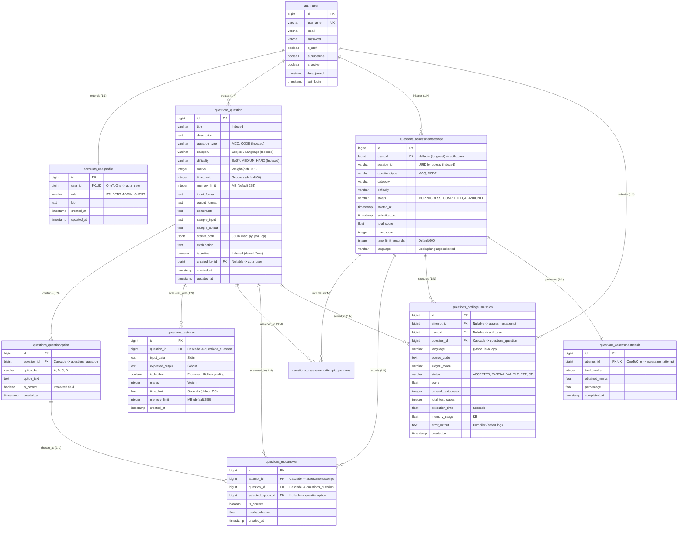

# SKILLBYTE — Relational Database Specification & ER Architecture

> **Document ID**: `DELIV-02`  
> **Classification**: Database Schema Specification & Data Dictionary  
> **Release Target**: SkillByte v1.0.0 (`v1.0.0-final-release`)  
> **Engine**: PostgreSQL 15+ Exclusively (No SQLite Fallback per SRS Specification)  

---

## 1. Relational Schema Overview & PostgreSQL Exclusivity

SkillByte is built around a relational data model designed to support the dual requirements of theoretical Multiple Choice Question (MCQ) assessments and practical Live Coding assessments.

### 1.1 Architectural Rationale for PostgreSQL Exclusivity
The SkillByte Software Requirements Specification (SRS) expressly mandates the exclusive use of **PostgreSQL**:
1. **Concurrent Assessment Integrity**: In a high-concurrency exam scenario where hundreds of students submit answers and trigger Judge0 evaluations simultaneously, SQLite's database-level write lock causes thread starvation and transaction timeouts. PostgreSQL's Multi-Version Concurrency Control (MVCC) provides row-level locking, ensuring concurrent writes never block concurrent reads.
2. **Native JSONField Indexing**: Coding problems require starter code templates across multiple programming languages (Python, Java, C++). Storing these in PostgreSQL native JSONB/JSONField columns allows flexible template retrieval without relational sprawl.
3. **Strict Constraints & Foreign Key Enforcement**: Foreign key cascading semantics (`CASCADE` for dependent MCQ options and answers; `SET_NULL` for user disassociation) are enforced at the database kernel level rather than relying on application-level integrity.

---

## 2. Full Entity-Relationship Diagram (Mermaid `erDiagram`)

---

## 3. Comprehensive Data Dictionary

---

### 3.1 Entity: `auth_user` (Django Core Authentication)
Represents system user credentials.
- **Physical Table**: `auth_user`
- **Module**: `django.contrib.auth.models.User`

| Field | SQL Type | Constraints | Default | Description |
|---|---|---|---|---|
| `id` | `BIGINT` | `PK`, `AUTO_INCREMENT` | — | Unique user identifier. |
| `username` | `VARCHAR(150)` | `UNIQUE`, `NOT NULL` | — | Alphanumeric handle for login. |
| `email` | `VARCHAR(254)` | `INDEXED` | — | User email address (supports email login). |
| `password` | `VARCHAR(128)` | `NOT NULL` | — | PBKDF2 with SHA-256 hashed password string. |
| `is_staff` | `BOOLEAN` | `NOT NULL` | `False` | Grants access to Django admin site. |
| `is_superuser` | `BOOLEAN` | `NOT NULL` | `False` | Grants all permissions without explicit assignment. |
| `is_active` | `BOOLEAN` | `NOT NULL` | `True` | Soft-delete / account active flag. |
| `date_joined` | `TIMESTAMP WITH TZ` | `NOT NULL` | `now()` | Timestamp of account registration. |
| `last_login` | `TIMESTAMP WITH TZ` | `NULLABLE` | `NULL` | Timestamp of most recent authentication. |

---

### 3.2 Entity: `accounts_userprofile` (Role & Profile Extension)
Extends standard Django user model with role-based access control and bio data.
- **Physical Table**: `accounts_userprofile`
- **Module**: `accounts.models.UserProfile`
- **Architectural Note**: OneToOne relationship preserves standard Django authentication tables while isolating custom role logic.

| Field | SQL Type | Constraints | Default | Description |
|---|---|---|---|---|
| `id` | `BIGINT` | `PK`, `AUTO_INCREMENT` | — | Primary key. |
| `user_id` | `BIGINT` | `FK`, `UNIQUE`, `NOT NULL`, `ON DELETE CASCADE` | — | Reference to `auth_user.id`. |
| `role` | `VARCHAR(20)` | `INDEXED`, `NOT NULL` | `'STUDENT'` | Enum: `STUDENT`, `ADMIN`, `GUEST`. |
| `bio` | `TEXT` | `NOT NULL` | `''` | Student biographical note. |
| `created_at` | `TIMESTAMP WITH TZ` | `NOT NULL` | `now()` | Record creation timestamp. |
| `updated_at` | `TIMESTAMP WITH TZ` | `NOT NULL` | `now()` | Record modification timestamp. |

---

### 3.3 Entity: `questions_question` (Unified Question Bank)
Houses both theoretical MCQ questions and practical coding challenges.
- **Physical Table**: `questions_question`
- **Module**: `questions.models.Question`

| Field | SQL Type | Constraints | Default | Description |
|---|---|---|---|---|
| `id` | `BIGINT` | `PK`, `AUTO_INCREMENT` | — | Primary key. |
| `title` | `VARCHAR(255)` | `INDEXED`, `NOT NULL` | — | Problem or question headline. |
| `description` | `TEXT` | `NOT NULL` | — | Full problem statement / question body. |
| `question_type` | `VARCHAR(10)` | `INDEXED`, `NOT NULL` | `'MCQ'` | Enum: `MCQ`, `CODE`. |
| `category` | `VARCHAR(50)` | `INDEXED`, `NOT NULL` | — | Enum: GK, English, Mathematics, Python, Java, C++, DSA. |
| `difficulty` | `VARCHAR(10)` | `INDEXED`, `NOT NULL` | `'EASY'` | Enum: `EASY`, `MEDIUM`, `HARD`. |
| `marks` | `INTEGER` | `NOT NULL` | `1` | Weight / maximum marks assigned. |
| `time_limit` | `INTEGER` | `NOT NULL` | `60` | For MCQ: seconds allocated; for Code: execution timeout. |
| `memory_limit` | `INTEGER` | `NOT NULL` | `256` | RAM ceiling in MB during code execution. |
| `input_format` | `TEXT` | `NOT NULL` | `''` | Coding problem input specification. |
| `output_format` | `TEXT` | `NOT NULL` | `''` | Coding problem expected output specification. |
| `constraints` | `TEXT` | `NOT NULL` | `''` | Problem constraints (e.g., $1 \le N \le 10^5$). |
| `sample_input` | `TEXT` | `NOT NULL` | `''` | Public sample stdin shown to students. |
| `sample_output` | `TEXT` | `NOT NULL` | `''` | Public sample stdout shown to students. |
| `starter_code` | `JSONB` | `NOT NULL` | `{}` | Language boilerplate map: `{"python": "...", "java": "..."}`. |
| `explanation` | `TEXT` | `NOT NULL` | `''` | Solution explanation revealed after assessment. |
| `is_active` | `BOOLEAN` | `INDEXED`, `NOT NULL` | `True` | Soft-deletion flag; inactive questions excluded from tests. |
| `created_by_id` | `BIGINT` | `FK`, `NULLABLE`, `ON DELETE SET_NULL` | `NULL` | Author reference (`auth_user.id`). |
| `created_at` | `TIMESTAMP WITH TZ` | `NOT NULL` | `now()` | Question creation timestamp. |
| `updated_at` | `TIMESTAMP WITH TZ` | `NOT NULL` | `now()` | Last modification timestamp. |

---

### 3.4 Entity: `questions_questionoption` (MCQ Answer Choices)
Stores candidate choices for MCQ questions.
- **Physical Table**: `questions_questionoption`
- **Module**: `questions.models.QuestionOption`
- **Unique Constraint**: `('question_id', 'option_key')`

| Field | SQL Type | Constraints | Default | Description |
|---|---|---|---|---|
| `id` | `BIGINT` | `PK`, `AUTO_INCREMENT` | — | Primary key. |
| `question_id` | `BIGINT` | `FK`, `NOT NULL`, `ON DELETE CASCADE` | — | Reference to `questions_question.id`. |
| `option_key` | `VARCHAR(10)` | `NOT NULL` | — | Option identifier (e.g., `'A'`, `'B'`, `'C'`, `'D'`). |
| `option_text` | `TEXT` | `NOT NULL` | — | Text content of the choice. |
| `is_correct` | `BOOLEAN` | `NOT NULL` | `False` | **Protected**: Indicates the correct answer choice. |
| `created_at` | `TIMESTAMP WITH TZ` | `NOT NULL` | `now()` | Timestamp created. |

---

### 3.5 Entity: `questions_testcase` (Coding Test Cases)
Defines inputs and expected outputs for sandbox evaluation.
- **Physical Table**: `questions_testcase`
- **Module**: `questions.models.TestCase`

| Field | SQL Type | Constraints | Default | Description |
|---|---|---|---|---|
| `id` | `BIGINT` | `PK`, `AUTO_INCREMENT` | — | Primary key. |
| `question_id` | `BIGINT` | `FK`, `NOT NULL`, `ON DELETE CASCADE` | — | Reference to `questions_question.id`. |
| `input_data` | `TEXT` | `NOT NULL` | — | Input string provided via `stdin`. |
| `expected_output` | `TEXT` | `NOT NULL` | — | Exact expected string on `stdout`. |
| `is_hidden` | `BOOLEAN` | `NOT NULL` | `False` | **Protected**: If `True`, used exclusively for grading and hidden from students. |
| `marks` | `INTEGER` | `NOT NULL` | `1` | Point weight for passing this specific test case. |
| `time_limit` | `FLOAT` | `NOT NULL` | `2.0` | CPU time ceiling in seconds. |
| `memory_limit` | `INTEGER` | `NOT NULL` | `256` | Memory quota in megabytes. |
| `created_at` | `TIMESTAMP WITH TZ` | `NOT NULL` | `now()` | Creation timestamp. |

---

### 3.6 Entity: `questions_assessmentattempt` (Assessment Sessions)
Tracks an active or completed assessment session initiated by a student or guest.
- **Physical Table**: `questions_assessmentattempt`
- **Module**: `questions.models.AssessmentAttempt`

| Field | SQL Type | Constraints | Default | Description |
|---|---|---|---|---|
| `id` | `BIGINT` | `PK`, `AUTO_INCREMENT` | — | Primary key. |
| `user_id` | `BIGINT` | `FK`, `NULLABLE`, `ON DELETE SET_NULL` | `NULL` | Student reference; `NULL` for guest attempts. |
| `session_id` | `VARCHAR(100)` | `INDEXED`, `NOT NULL` | `''` | Guest session UUID identifier. |
| `question_type` | `VARCHAR(10)` | `NOT NULL` | — | Enum: `MCQ`, `CODE`. |
| `category` | `VARCHAR(50)` | `NOT NULL` | — | Subject or programming language. |
| `difficulty` | `VARCHAR(10)` | `NOT NULL` | `'EASY'` | Assessment difficulty level. |
| `status` | `VARCHAR(20)` | `INDEXED`, `NOT NULL` | `'IN_PROGRESS'` | Enum: `IN_PROGRESS`, `COMPLETED`, `ABANDONED`. |
| `started_at` | `TIMESTAMP WITH TZ` | `NOT NULL` | `now()` | Server-authoritative start timestamp. |
| `submitted_at` | `TIMESTAMP WITH TZ` | `NULLABLE` | `NULL` | Submission / completion timestamp. |
| `total_score` | `FLOAT` | `NOT NULL` | `0.0` | Total marks obtained in this attempt. |
| `max_score` | `INTEGER` | `NOT NULL` | `0` | Total potential marks for this attempt. |
| `time_limit_seconds` | `INTEGER` | `NOT NULL` | `600` | Duration allocated for attempt in seconds. |
| `language` | `VARCHAR(30)` | `NOT NULL` | `''` | Selected programming language for coding attempt. |

---

### 3.7 Entity: `questions_mcqanswer` (Student MCQ Selections)
Records individual question responses within an MCQ assessment session.
- **Physical Table**: `questions_mcqanswer`
- **Module**: `questions.models.MCQAnswer`
- **Unique Constraint**: `('attempt_id', 'question_id')`

| Field | SQL Type | Constraints | Default | Description |
|---|---|---|---|---|
| `id` | `BIGINT` | `PK`, `AUTO_INCREMENT` | — | Primary key. |
| `attempt_id` | `BIGINT` | `FK`, `NOT NULL`, `ON DELETE CASCADE` | — | Reference to `assessmentattempt.id`. |
| `question_id` | `BIGINT` | `FK`, `NOT NULL`, `ON DELETE CASCADE` | — | Reference to `questions_question.id`. |
| `selected_option_id` | `BIGINT` | `FK`, `NULLABLE`, `ON DELETE SET_NULL` | `NULL` | Reference to chosen `questionoption.id`. |
| `is_correct` | `BOOLEAN` | `NOT NULL` | `False` | Whether selected option was the correct one. |
| `marks_obtained` | `FLOAT` | `NOT NULL` | `0.0` | Points awarded for this question. |
| `created_at` | `TIMESTAMP WITH TZ` | `NOT NULL` | `now()` | Timestamp answer was selected. |

---

### 3.8 Entity: `questions_codingsubmission` (Coding Verdicts & Telemetry)
Stores code executions, compilation results, and Judge0 telemetry.
- **Physical Table**: `questions_codingsubmission`
- **Module**: `questions.models.CodingSubmission`

| Field | SQL Type | Constraints | Default | Description |
|---|---|---|---|---|
| `id` | `BIGINT` | `PK`, `AUTO_INCREMENT` | — | Primary key. |
| `attempt_id` | `BIGINT` | `FK`, `NULLABLE`, `ON DELETE SET_NULL` | `NULL` | Reference to `assessmentattempt.id`. |
| `user_id` | `BIGINT` | `FK`, `NULLABLE`, `ON DELETE SET_NULL` | `NULL` | Reference to `auth_user.id`. |
| `question_id` | `BIGINT` | `FK`, `NOT NULL`, `ON DELETE CASCADE` | — | Reference to `questions_question.id`. |
| `language` | `VARCHAR(30)` | `NOT NULL` | — | Programming language (e.g., `'python'`, `'java'`). |
| `source_code` | `TEXT` | `NOT NULL` | — | Full source code string submitted. |
| `judge0_token` | `VARCHAR(100)` | `NOT NULL` | `''` | Judge0 submission tracking token. |
| `status` | `VARCHAR(30)` | `INDEXED`, `NOT NULL` | `'PENDING'` | Enum: `ACCEPTED`, `PARTIAL`, `WRONG_ANSWER`, `COMPILATION_ERROR`, `RUNTIME_ERROR`, `TIME_LIMIT_EXCEEDED`, `SERVICE_UNAVAILABLE`. |
| `score` | `FLOAT` | `NOT NULL` | `0.0` | Evaluated score / partial credit points. |
| `passed_test_cases` | `INTEGER` | `NOT NULL` | `0` | Count of test cases successfully passed. |
| `total_test_cases` | `INTEGER` | `NOT NULL` | `0` | Total test cases evaluated. |
| `execution_time` | `FLOAT` | `NULLABLE` | `NULL` | CPU execution time in seconds. |
| `memory_usage` | `FLOAT` | `NULLABLE` | `NULL` | RAM consumption in kilobytes. |
| `error_output` | `TEXT` | `NOT NULL` | `''` | Compiler diagnostics or runtime stacktrace. |
| `created_at` | `TIMESTAMP WITH TZ` | `NOT NULL` | `now()` | Submission timestamp. |

---

### 3.9 Entity: `questions_assessmentresult` (Final Assessment Summary)
Provides a high-level summary of an assessment attempt upon completion.
- **Physical Table**: `questions_assessmentresult`
- **Module**: `questions.models.AssessmentResult`

| Field | SQL Type | Constraints | Default | Description |
|---|---|---|---|---|
| `id` | `BIGINT` | `PK`, `AUTO_INCREMENT` | — | Primary key. |
| `attempt_id` | `BIGINT` | `FK`, `UNIQUE`, `NOT NULL`, `ON DELETE CASCADE` | — | Reference to `assessmentattempt.id`. |
| `total_marks` | `INTEGER` | `NOT NULL` | `0` | Maximum possible marks for the attempt. |
| `obtained_marks` | `FLOAT` | `NOT NULL` | `0.0` | Total marks achieved by the candidate. |
| `percentage` | `FLOAT` | `NOT NULL` | `0.0` | Calculated percentage score. |
| `completed_at` | `TIMESTAMP WITH TZ` | `NOT NULL` | `now()` | Completion timestamp. |

---

## 4. Database Indexes & Query Optimization Matrix

| Table | Index Columns | Type | Purpose |
|---|---|:---:|---|
| `accounts_userprofile` | `role` | B-Tree | Fast lookup for RBAC permission checks. |
| `questions_question` | `title` | B-Tree | Keyword search in admin question bank. |
| `questions_question` | `question_type` | B-Tree | High-selectivity filter separating MCQs from Coding. |
| `questions_question` | `category` | B-Tree | Filtering questions by subject or language. |
| `questions_question` | `difficulty` | B-Tree | Filtering by difficulty (Easy, Medium, Hard). |
| `questions_question` | `is_active` | B-Tree | Excludes archived / soft-deleted questions. |
| `questions_assessmentattempt` | `session_id` | B-Tree | Fast retrieval of guest session state. |
| `questions_assessmentattempt` | `status` | B-Tree | Fast discovery of in-progress attempts (`/api/assessments/active/`). |
| `questions_codingsubmission` | `status` | B-Tree | Rapid filtering by verdict (Accepted, Partial, etc.). |

---

## 5. Security & Sensitive Field Isolation at the Schema Level

SkillByte implements defense-in-depth data protection at the schema level:
1. **Protected Answer Keys (`questions_questionoption.is_correct`)**:
   - The boolean flag indicating correctness is strictly stripped by `QuestionOptionSerializer` on student-facing endpoints.
   - Evaluated exclusively on the server inside atomic transaction blocks.
2. **Hidden Test Cases (`questions_testcase.is_hidden`)**:
   - Test cases flagged with `is_hidden=True` are never transmitted to the client.
   - The student view only receives public sample test cases (`is_hidden=False`) with input and expected output.
   - Hidden test cases are queried internally by `CodingAssessmentSubmitView` to grade final submissions.
3. **Session Demarcation**:
   - Guest attempts are isolated by unique cryptographic session UUIDs (`session_id`).
   - Student attempts require an authenticated foreign key link to `auth_user.id`.

