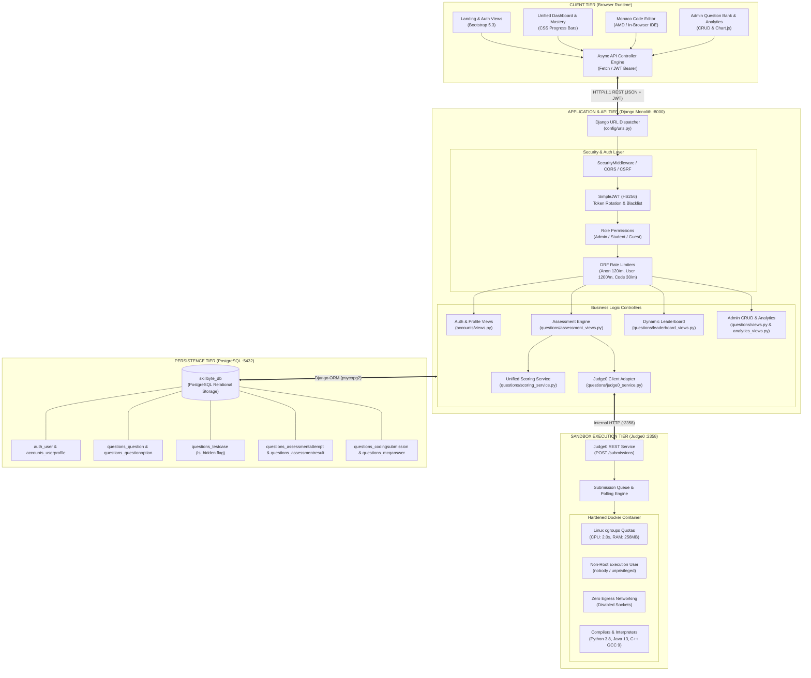
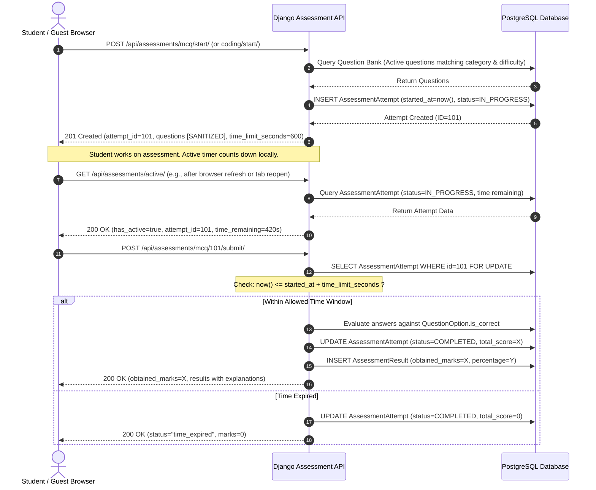
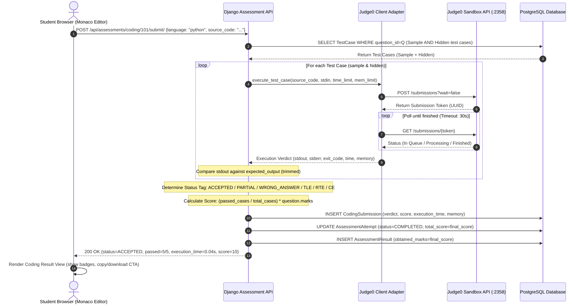
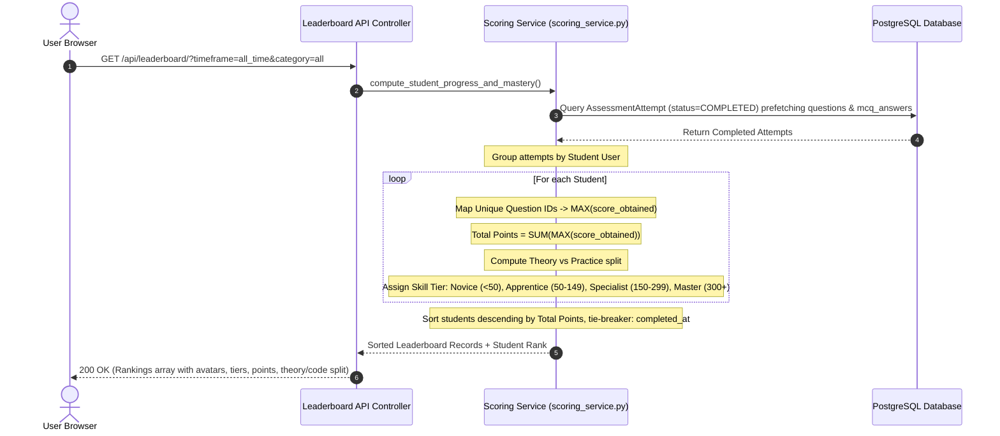

# SKILLBYTE — System Architecture & Engineering Blueprint

> **Document ID**: `DELIV-01`  
> **Classification**: Technical Architectural Specification  
> **Release Target**: SkillByte v1.0.0 (`v1.0.0-final-release`)  
> **System Philosophy**: *"Where Theory Meets Practice"* — Unified Hybrid Assessment Platform  

---

## 1. Architectural Philosophy: The Monolithic REST Pattern

SkillByte is architectured around a **Monolithic REST Design Pattern**. Rather than adopting an overly complex distributed microservices topology or a completely disconnected Single Page Application (SPA), SkillByte balances architectural simplicity, operational velocity, and high security by pairing:
1. **A Unified Django 4.2+ Application Kernel**: Serves base HTML5 document shells, enforces HTTP-level security (CSRF, X-Frame-Options, Content-Type headers), resolves routes, and hosts the administrative interface.
2. **Decoupled RESTful API Services**: Built with Django REST Framework (DRF), providing stateless, JSON-serialized communication for all dynamic platform capabilities (authentication, assessment lifecycle, code submission, leaderboard, and analytics).
3. **An In-Browser Client Controller Layer**: Vanilla ES6+ JavaScript modules and the Monaco Editor (the editor engine behind Visual Studio Code) that consume the REST APIs asynchronously without full-page reloads.
4. **An Isolated Sandbox Micro-Tier**: A self-hosted, containerized Judge0 execution engine communicating exclusively over internal HTTP to compile and execute untrusted student code within hardened Docker containers.
5. **An Exclusively Relational Persistence Tier**: PostgreSQL 15+ managing ACID transactions, complex aggregations, and strict referential integrity. (SQLite fallback is strictly prohibited per the project SRS).

```
+-------------------------------------------------------------------------+
|                              CLIENT TIER                                |
|  HTML5 + Bootstrap 5.3 + Monaco Editor + Vanilla JS Fetch Controllers   |
+------------------------------------+------------------------------------+
                                     |  HTTP / JSON (JWT Bearer Token)
                                     v
+-------------------------------------------------------------------------+
|                           APPLICATION TIER                              |
|           Django 4.2 Monolith + Django REST Framework Kernel            |
|   - URL Routing & Base Views           - Role-Based Access Control      |
|   - SimpleJWT Authentication & Blacklist - Zero-Leakage Data Sanitization|
|   - Assessment State Engine            - Best-Score Deduplicated Scoring|
+-------------------+--------------------------------+--------------------+
                    |                                |
   Internal HTTP    |                                |  PostgreSQL Driver
   (Port 2358)      v                                v  (Port 5432)
+-----------------------------------+  +----------------------------------+
|      SANDBOXED EXECUTION TIER     |  |         PERSISTENCE TIER         |
|      Self-Hosted Judge0 API       |  |      PostgreSQL 15 Database      |
|  - Worker Queue & Redis Broker    |  |  - User & Profile Tables         |
|  - Isolated Docker Sandbox Pods   |  |  - Question Bank & Test Cases    |
|  - Linux cgroups (CPU/RAM Caps)   |  |  - Attempts & Result Submissions |
|  - No Egress Network Access       |  |  - Best-Score Deduplication Views|
+-----------------------------------+  +----------------------------------+
```

---

## 2. Multi-Tier Architecture Diagram

The multi-tier architecture illustrates the physical and logical boundaries of the SkillByte ecosystem:



---

## 3. Tier Responsibilities & Structural Component Details

### 3.1 Client Tier (Presentation & Interaction)
- **Framework & Libraries**: Bootstrap 5.3 CSS framework, Bootstrap Icons, Monaco Editor (v0.34+ loaded asynchronously via AMD require), Vanilla JavaScript ES6+.
- **Key Responsibilities**:
  - Maintains client-side UI state, including the dynamic timer synchronized with server-authoritative timestamps.
  - Hosts the embedded code editor with customizable themes (Visual Studio Dark, Light), automated tab sizing, line numbers, and language modes (Python, Java, C++).
  - Handles client-side code operations: Copy Solution (Clipboard API with UI toast), Code File Download (`.py`, `.java`, `.cpp` blob generation), and Practice Again workflows.
  - Communicates with backend endpoints using standard `fetch()` API calls with automatic Bearer token insertion from `localStorage`.

### 3.2 Web & API Application Tier (Django & DRF)
- **Framework & Libraries**: Python 3.10+, Django 4.2+, Django REST Framework (DRF), `djangorestframework-simplejwt`, `django-cors-headers`.
- **Key Responsibilities**:
  - **Security & Authorization**: Enforces role hierarchy (`ADMIN`, `STUDENT`, `GUEST`) via custom permissions (`accounts/permissions.py`).
  - **Zero-Leakage Data Sanitization**: `QuestionOptionSerializer` automatically strips `is_correct` during active assessments; `TestCaseSerializer` automatically strips hidden test cases (`is_hidden=True`) from student payloads.
  - **Assessment Lifecycle Engine**: Manages attempt initiation, active session discovery (`/api/assessments/active/`), server-side timeout enforcement, question recovery, and abandonment.
  - **Unified Scoring Engine**: Computes overall points using the **Best Score per Unique Question** deduplication formula (`questions/scoring_service.py`), dynamically categorizing students into skill tiers (*Novice*, *Apprentice*, *Specialist*, *Master*).
  - **Rate Limiting**: Protects authentication endpoints (15 req/min) and code execution (30 req/min) using DRF scoped throttling.
  - **Custom Error Handling**: Renders branded, informative 404, 403, and 500 pages matching the SkillByte theme.

### 3.3 Sandboxed Execution Tier (Judge0 Microservice)
- **Deployment**: Standalone self-hosted Judge0 instance running on port `2358`.
- **Key Responsibilities**:
  - Receives source code, standard input (`stdin`), time limits, and memory quotas from Django.
  - Dispatches execution to isolated Docker containers running under unprivileged user contexts (`nobody`).
  - Limits resources using Linux Control Groups (cgroups): default CPU execution timeout of 2.0 seconds, memory cap of 256 MB.
  - Completely severs outbound networking inside worker containers to prevent socket binding, port scanning, data exfiltration, or Server-Side Request Forgery (SSRF).
  - Collects and returns precise compiler logs, runtime exceptions, standard output, execution time (in seconds), and memory consumption (in KB).

### 3.4 Data & Persistence Tier (PostgreSQL)
- **Database Engine**: PostgreSQL 15/16 listening on port `5432`.
- **Key Responsibilities**:
  - Guarantees strict transactional integrity (`transaction.atomic`) during answer grading and code submission recording.
  - Manages primary/foreign keys with explicit cascade semantics (`CASCADE` for dependent answers; `SET_NULL` for audit trails upon user deletion).
  - Stores problem starter codes and language templates within native JSONField columns.
  - Houses indexed lookup fields on frequently queried properties (`question_type`, `category`, `difficulty`, `is_active`, `session_id`).

---

## 4. Critical Execution Sequence Diagrams

---

### Sequence 1: Assessment Lifecycle (MCQ & Coding)

The assessment lifecycle is strictly server-authoritative. The client timer is for presentation; the backend validates elapsed time upon final submission.



---

### Sequence 2: Live Code Execution & Verdict Pipeline

Demonstrates the decoupled communication between Monaco, Django, and Judge0 during a code submission.



---

### Sequence 3: Unified Scoring & Leaderboard Aggregation

Illustrates the **Best Score per Unique Question** deduplication pipeline that prevents score farming.



---

## 5. Security Boundaries & Trust Zones

The system is compartmentalized into three distinct trust zones:

```
+--------------------------------------------------------------------------+
| ZONE 1: PUBLIC / UNTRUSTED CLIENT NETWORK                                |
| - End-user web browsers, public internet connections.                    |
| - Attack Vectors: XSS, parameter tampering, token theft, timer bypass.   |
| - Controls: HTTPS, strict CSP, input validation, server-side timer.      |
+------------------------------------+-------------------------------------+
                                     | Firewalled HTTPS (TLS 1.3)
                                     v
+--------------------------------------------------------------------------+
| ZONE 2: APPLICATION RUNTIME ZONE (Host System)                           |
| - Django monolith running behind Gunicorn / Nginx on localhost:8000.     |
| - Direct access to PostgreSQL on localhost:5432 (protected by password). |
| - Secret Key, JWT signing keys, environment credentials live here.       |
| - Controls: Principle of Least Privilege, parameterized queries.         |
+------------------------------------+-------------------------------------+
                                     | Internal HTTP (:2358)
                                     v
+--------------------------------------------------------------------------+
| ZONE 3: ISOLATED CONTAINER SANDBOX (Docker Engine)                       |
| - Docker containers spawned dynamically by Judge0 workers.               |
| - Untrusted student code compiles and runs here.                         |
| - Controls: Non-root user, cgroups CPU/memory caps, NO network access.   |
| - Total blast radius containment: Container crash does NOT affect host.  |
+--------------------------------------------------------------------------+
```

---

## 6. Runtime Specifications & Port Allocation

| Component | Service | Bound Host | Port | Protocol | Access Policy |
|---|---|---|:---:|:---:|---|
| **Web Server** | Django Monolith (Gunicorn/Runserver) | `127.0.0.1` | **8000** | HTTP / WSGI | Public (proxied by Nginx in production) |
| **Relational DB** | PostgreSQL 15/16 Engine | `127.0.0.1` | **5432** | TCP / Postgres | Private (Accessible only to Django backend) |
| **Code Execution** | Judge0 Microservice API | `127.0.0.1` | **2358** | HTTP | Private (Accessible only to Django backend) |
| **Sandbox Workers** | Judge0 Docker Runner Containers | Internal Bridge | Dynamic | IPC / StdIO | Completely isolated; zero egress networking |

---

## 7. Architectural Decisions & Trade-Off Analysis

| Architectural Decision | Chosen Approach | Alternative Considered | Trade-Off Rationale |
|---|---|---|---|
| **Frontend Rendering Architecture** | Django Monolithic Templates + Vanilla ES6 JS Controllers + Monaco | Decoupled React / Vue Single Page Application | Eliminates state synchronization overhead, CORS complexity, and build pipeline dependencies (Webpack/Vite); keeps the code footprint compact while delivering desktop-grade IDE experience. |
| **Database Engine** | PostgreSQL Exclusively (Strictly no SQLite fallback) | SQLite 3 | SQLite lacks native support for concurrent write transactions during simultaneous timed assessments, lacks native JSONB indexing for starter code templates, and fails under multi-worker Gunicorn deployments. |
| **Code Sandboxing Engine** | Self-Hosted Judge0 in Docker Containers | Direct Python `subprocess` execution | Running student code directly on the host using `subprocess.run()` is vulnerable to shell breakouts, fork bombs, disk wiping (`rm -rf`), and host resource starvation. Judge0 enforces containerized cgroups isolation and zero network access. |
| **Scoring Model** | Best Score per Unique Question Deduplication | Cumulative Lifetime Scoring | Simple score accumulation allows students to artificially inflate their ranking by repeatedly submitting the same trivial questions. Best-score deduplication rewards breadth of mastery and genuine skill progression. |
| **Authentication Flow** | Stateless JWT (SimpleJWT) with Refresh Token Blacklisting | Traditional Cookie Sessions only | Enables clean REST API interactions for asynchronous Monaco code execution and potential future mobile clients, while token blacklisting ensures immediate revocation upon logout. |

